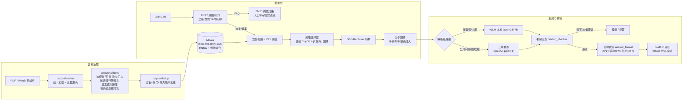

# 法衡 · 法律检索与微调问答系统（lexanswer-rag）

> 面向律所私有化环境的「法规检索 + 大模型问答」全链路参考实现：
> 语料治理 → 混合检索 → QLoRA 微调 → 生成服务 → 引用回查拒答 → 内网部署。

## 一、项目背景

本仓库源自一个虚构但工程上完全可落地的场景：一家**中型律所**——
约 80 名律师、三个业务部门（公司业务部、诉讼仲裁部、数据合规部），
拟建设内部法律问答系统。两条硬约束决定了全部技术选型：

1. **「案卷不出内网」**：客户的合同、起诉状、证据材料属于最高敏感级
   数据，任何环节不得外发至公网模型 API；
2. **单卡 RTX 4090（24GB）**：无 A100/H800 集群预算，大模型方案必须
   在消费级显卡上完成微调与推理。

因此系统采用「检索为主干、微调为增益、校验为闸门」的架构：
7B 级模型（Qwen2.5-7B-Instruct）经 QLoRA 微调后由 vLLM 私有化部署，
回答必须能回查到知识库中的现行有效条文，否则澄清或拒答。

## 二、架构总览



## 三、全链路说明

### 3.1 语料治理
法规按「章→节→条→款/项」构建**父子块**：条级父块自带
`《法名》第N条` 引头，款/项级子块持有 `parent_id` 指针；附表按行切分
并携带表头语义；类案文书用语义断崖切分；咨询记录按问答轮次成对切分。
入库前经法名/条号/效力状态三维去重，**废止条文不删除**，转入
微调拒答负样本池（详见 `docs/chunking.md`）。

### 3.2 检索
BGE-M3 一次编码产出稠密+稀疏双路向量，Milvus 单 collection
混合检索、RRF 融合；BERT 意图闸门把闲聊挡在检索之外、FAQ 走
BM25 阈值短路；召回质量不足时依次触发 HyDE 假设文档、子查询
拆分、父块回溯三种改写策略；精排后子块命中一律回溯父块整条注入。

### 3.3 微调
Qwen2.5-7B-Instruct 上 QLoRA：NF4 4-bit + 双重量化、bf16 计算、
梯度检查点，适配器挂 attention 与 FFN 全部 7 个投影，可训参数
约 0.57%，有效 batch 16、序列 2048、3 轮。指令集为 ShareGPT 格式，
正样本强制「原文/适用条件/结论/建议」四段式，负样本专训
「已废止或不存在法条必须拒答」（详见 `docs/finetune_report.md`）。

### 3.4 生成与校验
模型网关抽象为 OpenAI 兼容协议，不绑定厂商；按数据敏感级路由：
涉案情信号一律本地 7B，公开问题脱敏后可走云端（详见
`docs/security.md`）。回答后逐条抽取 `《法名》第N条` 与召回法条
回查比对：编号错引/内容不匹配触发澄清，知识库查无此条触发拒答。

### 3.5 部署
Docker Compose 一键拉起 api / Milvus / MySQL / Redis / vLLM，
全部组件运行于律所内网，仅模型权重文件允许经审计后带入。

## 四、微调成果（同一检索结果集、只换模型的 A/B 对照）

| 指标 | 基座 Qwen2.5-7B-Instruct | QLoRA 微调后 | 说明 |
|---|---|---|---|
| 回答准确率 | 52.3% | **81.5%** | 行为+引用+场景+格式四层全对 |
| 法条引用准确率 | 34.7% | **83.6%** | 与召回条文回查 EXACT 的比例 |
| 训练成本 | — | 单卡 24GB · 3 轮 · 约 4.5h | QLoRA NF4+双重量化 |
| 推理首 Token | — | 约 0.5s | vLLM，4096 上下文 |
| 生成吞吐 | — | 35–40 token/s | 单卡 |
| 并发能力 | — | 4–8 路 | 质量/延迟平衡点 |

评测方法：`eval/run_ab_eval.py` 对每个样本**只跑一次检索**，
基座与微调模型在同一上下文上生成，再统一过引用回查与结构校验——
准确率变化只能归因于模型本身，排除检索波动干扰。错误按
「编号错引 / 内容不匹配 / 适用场景错误 / 法条幻觉 / 该拒未拒 /
不该拒却拒 / 格式违规」分型统计，定位改进方向。
`eval/eval_set.jsonl` 提供 20 条自创样例（14 应答 + 4 应拒 + 2 边界），
口径与上表一致；裸环境以 MockGateway 双风格演示全链路。

## 五、快速开始

无需 GPU、无需任何密钥即可跑通数据构造、检索链路与 A/B 评测
（外部模型调用均有本地 mock 降级）：

```bash
pip install -r requirements.txt          # 核心链路仅需标准库+少量依赖

# 1. 语料切分 + 去重 + 混合检索演示
python -c "from eval.run_ab_eval import build_pipeline; p=build_pipeline('corpus/sample_data'); print(p.run('处理敏感个人信息需要单独同意吗？').context()[:200])"

# 2. 构造 ShareGPT 指令集（正样本 + 拒答负样本）
python -m finetune.build_dataset --corpus-dir corpus/sample_data

# 3. QLoRA 训练计划校验（无 GPU 自动进入 mock 模式）
python -m finetune.train_qlora --config finetune/configs/peft_lora.yaml

# 4. 前后对照 A/B 评测（mock 双风格演示）
python -m eval.run_ab_eval --detail

# 5. 启动 API（需 pip install fastapi uvicorn）
cp .env.example .env   # 按注释配置；留空则全 mock
uvicorn serving.api:create_app --factory --port 8080
```

真实部署（有卡环境）见 `deploy/README.md`。

## 六、目录结构

```
lexanswer-rag/
├── corpus/        # 语料治理：加载/切分/去重/元数据契约 + 示例法规
├── retrieval/     # 检索：BGE-M3 混合向量、Milvus、精排、父子回溯、
│                  #       意图闸门、多策略、FAQ BM25 短路
├── finetune/      # 微调：数据集构造、QLoRA 训练、适配器合并
├── serving/       # 服务：模型网关、敏感级路由、vLLM 启动、FastAPI
├── verify/        # 校验：法条引用抽取、回查拒答、四段式结构
├── eval/          # 评测：指标口径、错误分型、A/B 对照
├── docs/          # 切分设计 / 微调报告 / 安全方案
└── deploy/        # Dockerfile / Compose / 私有化手册
```

## 七、声明

- 示例法规（`corpus/sample_data/`）均为**虚构文本**，仅用于演示
  切分与检索链路，不构成任何法律意见；
- 项目背景律所、评测数字口径来自虚构的企业项目设定，
  与任何真实机构无关；
- 所有外部模型/存储调用均通过接口层封装，未配置时自动降级本地 mock，
  仓库内不包含任何密钥或可外发数据的默认配置。
